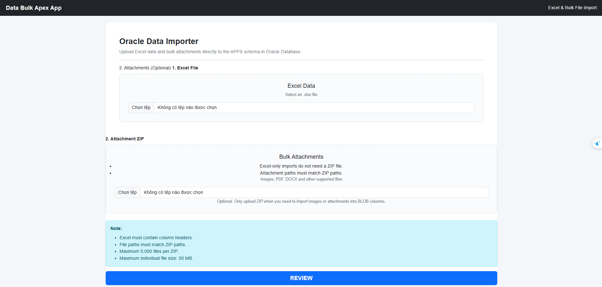
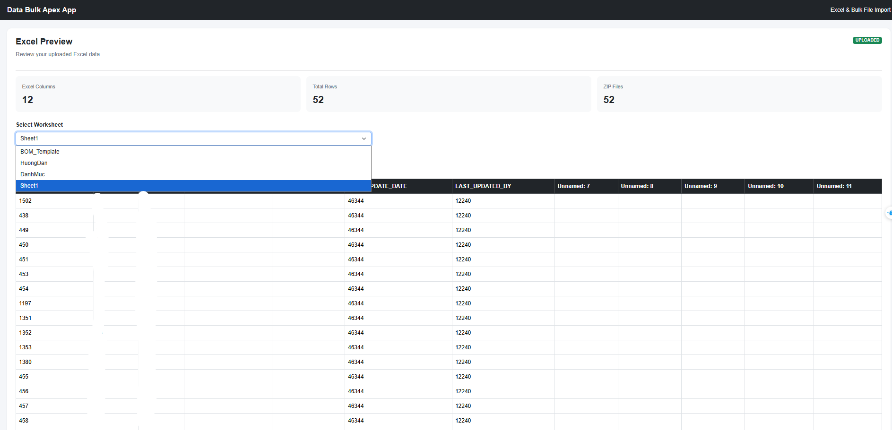
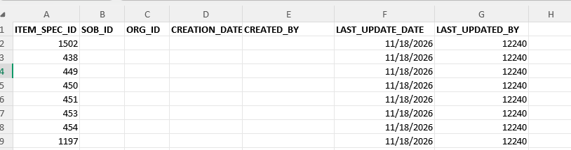
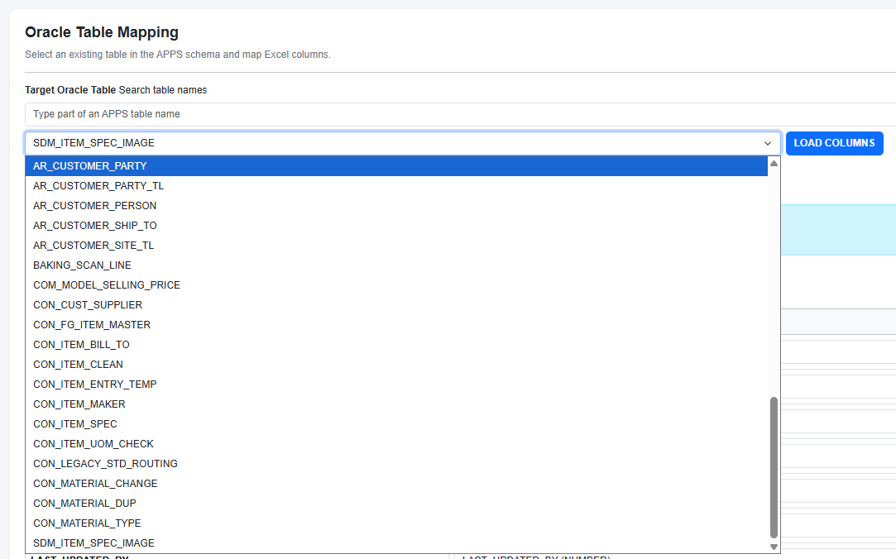
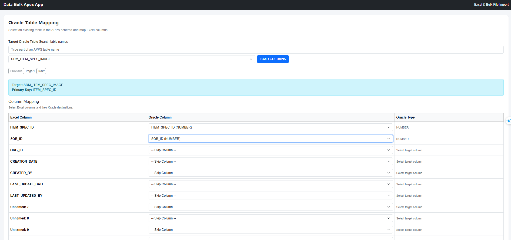
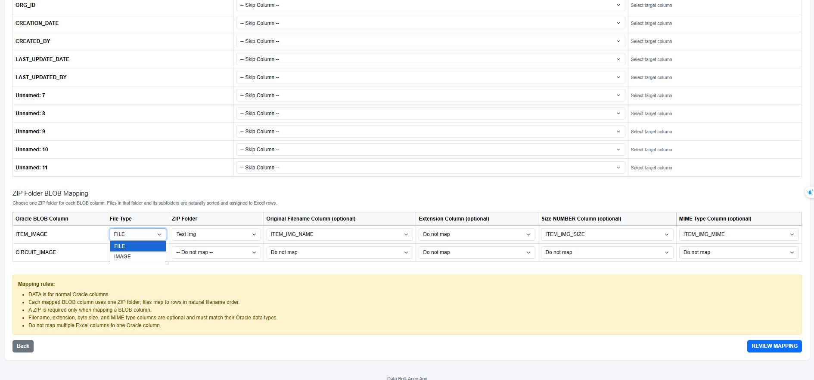
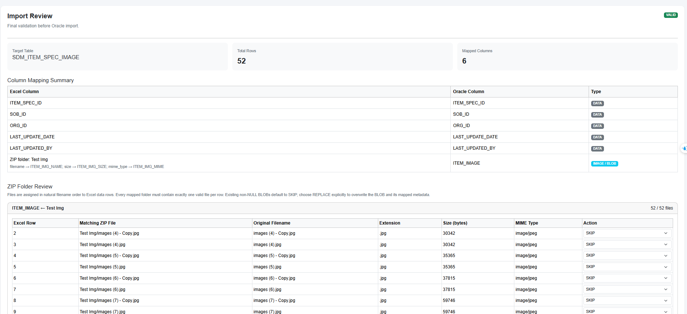
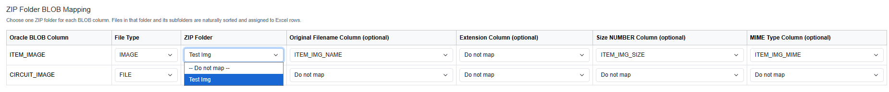
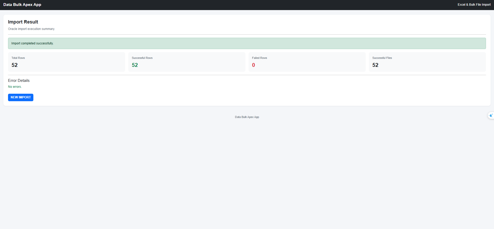

# Data Bulk APEX App

**A web-based tool for bulk importing Excel data and image/file attachments into Oracle Database.**

Data Bulk APEX App simplifies the process of importing structured data and BLOB attachments into existing Oracle Database tables through a web interface.

Users can upload Excel files, map columns, assign ZIP folders to BLOB columns, validate data, review attachment information, and execute bulk INSERT or UPDATE operations without writing SQL statements.

---

## Table of Contents

1. [Features](#1-features)
2. [System Requirements](#2-system-requirements)
3. [Application Workflow](#3-application-workflow)
4. [Excel File Preparation](#4-excel-file-preparation)
5. [ZIP File Preparation](#5-zip-file-preparation)
6. [Oracle Table Selection](#6-oracle-table-selection)
7. [Column Mapping](#7-column-mapping)
8. [ZIP Folder Mapping](#8-zip-folder-mapping)
9. [Data Validation and Review](#9-data-validation-and-review)
10. [Import Operations](#10-import-operations)
11. [Import Results](#11-import-results)
12. [Troubleshooting](#12-troubleshooting)
13. [Security Notes](#13-security-notes)
14. [Technology Stack](#14-technology-stack)

---

## 1. Features

- **Excel Upload:** Import structured data from `.xlsx` files.
- **ZIP Upload:** Upload images and file attachments in a ZIP archive.
- **Oracle Table Search:** Search available tables instead of manually scrolling through long table lists.
- **Dynamic Column Mapping:** Map Excel columns to existing Oracle columns.
- **ZIP Folder Mapping:** Assign different ZIP folders to different Oracle BLOB columns.
- **Automatic File Matching:** Match attachments to Excel rows based on filename ordering.
- **File Metadata Extraction:** Automatically extract original filename, extension, file size, and MIME type.
- **Data Validation:** Validate required fields, data types, and attachment information before importing.
- **Import Review:** Review mapped data and matched attachments before execution.
- **Bulk INSERT:** Insert new records into Oracle tables.
- **Bulk UPDATE:** Update existing records and add or replace BLOB attachments according to the selected options.
- **Batch Processing:** Process records in batches to manage memory consumption.

---

## 2. System Requirements

### User Requirements

- A modern web browser (Google Chrome, Microsoft Edge, Firefox).
- An Excel file (`.xlsx`).
- A ZIP archive containing attachments (optional).
- Oracle Database connection information.

### Server Requirements

- Python 3.10 or later.
- Oracle Database connectivity.
- Required Python packages listed in `requirements.txt`.

**Note:** Oracle Instant Client is required when the application uses `python-oracledb` Thick Mode. It must be installed on the machine running the Flask application, not on every user's computer.

---

## 3. Application Workflow

The general workflow is:

```text
Upload Excel and ZIP
        |
        v
Preview Excel Data
        |
        v
Select Oracle Database Table
        |
        v
Map Excel Columns
        |
        v
Assign ZIP Folders to BLOB Columns
        |
        v
Validate Data and Attachments
        |
        v
Review Import Information
        |
        v
Execute Bulk Import
        |
        v
View Import Results
```

### Step 1: Upload Files


[Home Page / Upload Interface]

Upload the Excel file containing the data.

If images or attachments are required, upload a ZIP archive containing the corresponding folders.

ZIP upload is optional when importing Excel data only.

### Step 2: Preview Excel Data


[Excel Preview]

Review the uploaded Excel file, including:

- Column headers.
- Sample records.
- Total number of rows.

Ensure that the Excel data is correct before proceeding.

---

## 4. Excel File Preparation

The first row of the Excel file should contain column headers.



### Guidelines

- Use unique column headers.
- Each subsequent row represents one database record.
- Include primary key values when updating existing records.
- Ensure that data types are compatible with the target Oracle columns.
- Avoid unnecessary blank rows and duplicate records.

---

## 5. ZIP File Preparation

When importing images or attachments, organize files into folders inside a ZIP archive.

Example:

```text
attachments.zip
│
├── item_images/
│   ├── 001.jpg
│   ├── 002.jpg
│   ├── 003.jpg
│   └── 004.jpg
│
└── circuit_images/
    ├── 001.png
    ├── 002.png
    ├── 003.png
    └── 004.png
```

Each folder can be assigned to a different Oracle BLOB column.

### File Matching Rules

- Files are matched according to filename ordering.
- The first file corresponds to the first applicable Excel row.
- The second file corresponds to the second applicable Excel row.
- Continue in the same order for subsequent records.
- Ensure that the number and order of files correspond to the intended Excel records.

**Important:** Always verify file matching on the Review page before importing.

[ADD SCREENSHOT HERE - ZIP Folder Structure]

---

## 6. Oracle Table Selection


[Oracle Table Search]

After previewing the Excel file:

1. Select the target Oracle table.
2. Use the search box to find a table by name.
3. Select the desired table.
4. Allow the application to retrieve its column metadata.

The application works with existing tables in the connected Oracle schema.

It does not automatically create or modify database tables.

---

## 7. Column Mapping



[Column Mapping Interface]

Map Excel columns to the corresponding Oracle columns.

### Optional File Metadata

The application can also store attachment information in separate Oracle columns.
Map these fields only when the corresponding columns exist in the target Oracle table.

---

## 8. ZIP Folder Mapping


[ZIP Folder Mapping Interface]

Assign each BLOB column to its corresponding ZIP folder.

This allows multiple attachment columns to be populated from different folders within the same ZIP archive.

Users do not need to enter individual file paths into Excel.

---

## 9. Data Validation and Review


[Validation Results]

Before importing, the application validates the mapped data.

Validation includes:

- Required Oracle columns.
- Data type compatibility.
- Invalid date and numeric values.
- Primary key values.
- Attachment availability.
- File extension and MIME type.
- File size.
- ZIP folder and file matching.

### Attachment Review


[Attachment Review Table]

The Review page displays attachment information such as:

| Field | Description |
|---|---|
| Excel Row | Corresponding Excel row |
| Matching ZIP File | Matched file path inside ZIP |
| Original Filename | Original file name |
| Extension | File extension |
| Size (bytes) | File size |
| MIME Type | File content type |
| Action | Validation and import status |

Resolve important validation errors before proceeding.

---

## 10. Import Operations

The application supports different operations depending on whether the target record and its BLOB data already exist.

### Case 1: New Record

If the primary key does not exist:

- INSERT a new record.
- Insert mapped Excel data.
- Insert BLOB attachments.
- Insert optional file metadata.

### Case 2: Existing Record Without Attachment

If the primary key already exists but the target BLOB column is NULL:

- UPDATE the existing record.
- Add the new BLOB attachment.
- Update its associated metadata columns.

### Case 3: Existing Record With Attachment

When the target BLOB column already contains data, users can choose:

| Action | Description |
|---|---|
| SKIP | Keep the existing attachment unchanged. |
| REPLACE | Overwrite the existing attachment with the new file. |

Replacement must be explicitly selected.

**Important:** Only the mapped BLOB and associated metadata columns should be updated for attachment replacement. Other existing record data should remain unchanged unless explicitly mapped for update.

---

## 11. Import Results


[Import Results Page]

After bulk import execution, review the results.

The application reports the import outcome, including successful records and failed operations where available.

For important imports, verify the resulting data and BLOB attachments in Oracle Database.

---

## 12. Troubleshooting

| Problem | Possible Solution |
|---|---|
| Cannot connect to Oracle | Check host, port, service name, username, password, and network access. |
| No tables displayed | Check schema configuration and database privileges. |
| Invalid date value | Check Excel date formatting and date conversion. |
| Missing ZIP attachments | Check folder assignments and filename ordering. |
| Invalid extension or MIME type | Check file format and validation rules. |
| Required column validation error | Map the required column or verify its database default. |
| Import failed | Check the displayed Oracle error and application logs. |
| BLOB uploaded but image not displayed | Verify the BLOB column, metadata columns, and the application's image retrieval/display logic. |

---

## 13. Security Notes

---

## 14. Technology Stack

| Technology | Purpose |
|---|---|
| Python | Application backend |
| Flask | Web framework |
| python-oracledb | Oracle Database connectivity |
| OpenPyXL | Excel file processing |
| Pandas | Data processing |
| HTML / CSS / JavaScript | Frontend interface |
| Oracle Database | Data and BLOB storage |

---

## License

Add your preferred license before distributing this project.

---

**Data Bulk APEX App**  
*Simplifying bulk data and attachment management in Oracle Database.*